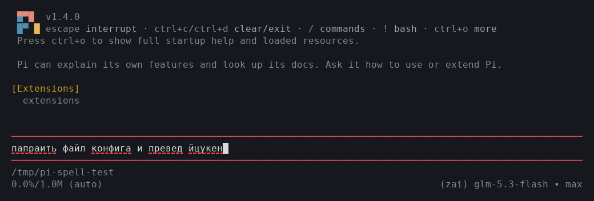
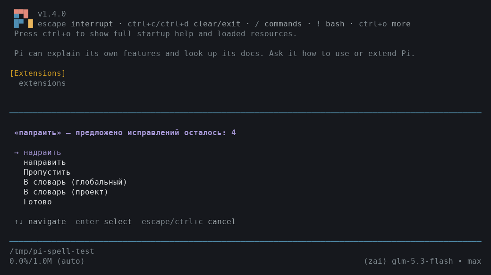
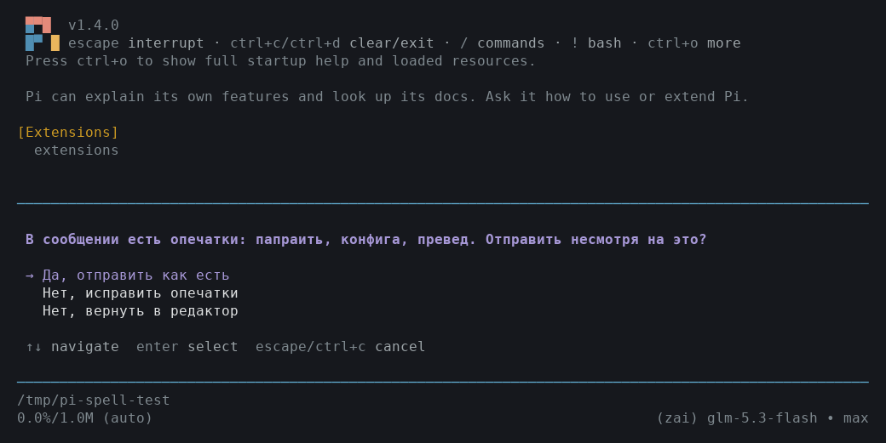

# pi-spellcheck

Проверка орфографии для [pi coding agent](https://github.com/earendil-works/pi-coding-agent): подчёркивание опечаток при наборе, русский и английский, личные словари и проверка перед отправкой.

## Зачем

Запрос агенту набирается текстом, и палец часто жмёт не ту букву. Сообщение уходит вместе с опечаткой, и иногда результат не тот, который ты просил: «поправить файл конфига» доходит как «папраить файл конфига», агент додумывает смысл и порой делает совсем не то, о чём просил.

В браузере опечатки видно до отправки. В терминале текст уходит «как есть», и ошибку не видно. Другие проверки для pi показывают ошибки по хоткею или через LLM, не в момент набора.

pi-spellcheck подчёркивает опечатки при наборе: hunspell, русский и английский, без LLM. По Win+S предлагает исправления и добавляет слова в личный словарь. Перед отправкой сообщение проверяется ещё раз: опечатку можно поправить, пока текст не ушёл.

## Скриншоты

Красный пунктир под опечатками, прямо в редакторе:



Диалог исправлений (Win+S): варианты, «пропустить», «добавить в личный словарь»:



Попытка отправить сообщение с опечатками (Enter): подтверждение «Отправить несмотря на это?»:



## Возможности

- **Подчёркивание при наборе** — красный пунктир под опечатками, как в браузерах (терминалы без поддержки стилей линии показывают обычное подчёркивание). Работает офлайн, без LLM; проверка занимает доли миллисекунды.
- **Русский + английский** — hunspell-словари в комплекте (ru_RU ~470k словоформ, en_US).
- **Диалог исправлений** (`Win+S`) — для каждого слова: варианты исправления, «пропустить», «добавить в личный словарь».
- **Проверка при отправке** — работает на всех путях отправки (Enter, Alt+Enter): если в сообщении остались опечатки, появится подтверждение «Отправить несмотря на это?» — да / исправить / вернуть в редактор. Esc в любом диалоге — отмена: текст целиком возвращается в редактор, ничего не отправляется.
- **Личные словари** — глобальный и проектный; пополняются из диалога или вручную.
- **Фильтры ложных срабатываний**: camelCase-идентификаторы (`TaskQueue`, `getUserById`), акронимы (`API`, `ТЗ`), пути и URL, `don't`-стяжения, дефисные слова (`по-русски`), начало набранного слова (`попра` при наборе «поправить»).

## Установка

```bash
pi install git:https://github.com/prikotov/pi-spellcheck
```

Словарь русского языка (~3.4 МБ) и nspell поставляются в комплекте — внешних зависимостей и загрузок при установке нет.

Для разработки: `pi -e ./extensions/index.ts`.

## Использование

| Действие | Как |
|---|---|
| Исправить текст в редакторе | `Win+S` (`super+s`; fallback: `alt+s`, `ctrl+;`) |
| Проверка при отправке | автоматически по Enter / Alt+Enter (отключить: `/spell gate off`) |
| Включить/выключить подчёркивание | `/spell on` / `/spell off` |
| Добавить слово в глобальный словарь | `/spell add слово` или из диалога |
| Перечитать словари | `/spell reload` |
| Статус | `/spell` |

### Словари

- Глобальный: `~/.pi/agent/spell-dict.txt`
- Проектный: `<проект>/.pi/spell-dict.txt`

Формат — одно слово на строку, строки с `#` — комментарии. Слова из диалога «В словарь (глобальный/проект)» дописываются автоматически.

### Настройки

`~/.pi/agent/spellcheck.json`:

```json
{
	"underline": true,
	"gate": true
}
```

## Ограничения

- Словарь ru_RU не содержит техно-сленга («конфиг», «дашборд», «виджет») — пополняйте личный словарь, `/spell reload` не требуется, слова подхватываются сразу.
- Подчёркивание не показывается на слове под курсором и на словах, разрезанных переносом строки.
- Диалог исправлений предлагает hunspell-варианты; для русского фонетические подсказки могут быть неточными.
- Проверяются только текстовые промпты до 100 КБ.
- Словари грузятся в worker-потоке ~2 секунды после старта: ввод не блокируется, подчёркивание появляется с задержкой. Отправка в первые секунды всё равно проверяется — gate ждёт загрузки словарей.

## Архитектура

```
extensions/index.ts   — расширение: редактор с подчёркиванием, super+s, gate, /spell
lib/checker.ts        — асинхронная обёртка: worker + кеш для рендера
lib/spell-core.ts     — SpellCore: nspell + эвристики + кеши
worker/spell-worker.mjs — worker thread: словари и проверки вне главного потока
lib/tokenizer.ts      — извлечение слов из произвольного текста
lib/underline.ts      — ANSI-безопасное подчёркивание в отрендеренных строках TUI
lib/settings.ts       — настройки и личные словари
vendor/nspell/        — nspell 2.1.5 (vendored, MIT)
dictionaries/         — ru_RU (BSD-3-Clause), en_US (MIT/LGPL)
```

## Тесты

```bash
npm test   # node --test, 26 тестов: словари, эвристики, подчёркивание, замены, рендер редактора
```

## Почему в репозитории vendor/ и dictionaries/

Пакет — самодостаточный: `pi install git:...` ничего не скачивает и не запускает npm-install, работает офлайн, а локальный запуск (`pi -e ./extensions/index.ts`) не требует установки зависимостей.

- `vendor/nspell/` — nspell 2.1.5 (MIT), стабильная и почти не меняющаяся библиотека; обновляется вручную при необходимости.
- `dictionaries/` — hunspell-словари ru_RU/en_US, обновляются вместе с выпусками wooorm/dictionaries.

Если предпочитаешь классические npm-зависимости — перенеси nspell в `dependencies` package.json и удали `vendor/` (учти: тогда `pi -e` потребует ручного `npm install`).

## Лицензии

- Код — MIT.
- [nspell](https://github.com/wooorm/nspell) — MIT (см. `vendor/nspell/license`).
- Русский словарь ru_RU — BSD-3-Clause, © 1997–2008 Alexander I. Lebedev (см. `dictionaries/LICENSE-ru`), дистрибуция через [wooorm/dictionaries](https://github.com/wooorm/dictionaries).
- Английский словарь en_US — см. `dictionaries/LICENSE-en` (wordlist.sourceforge.net), дистрибуция через [wooorm/dictionaries](https://github.com/wooorm/dictionaries).
